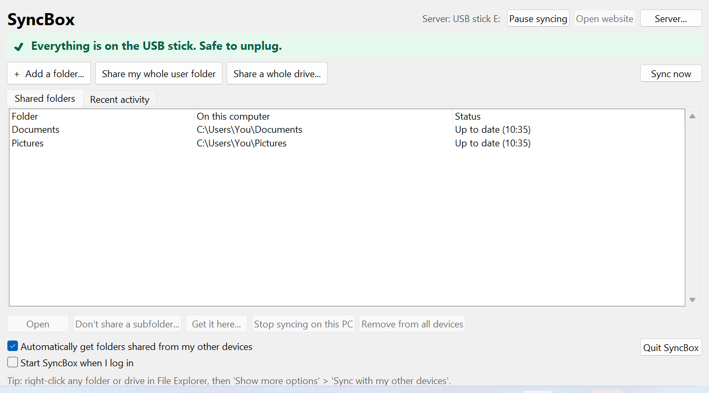
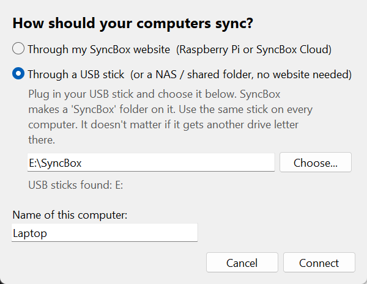

# SyncBox

**Your files on all your computers, on a server you control.**

Edit a file on your laptop, close it, start your PC, and it's already there. SyncBox keeps single folders, your whole user folder or entire drives in sync between your Windows computers. It works through a small server, such as a Raspberry Pi at home, that also gives you a website to reach your files from any browser.

No pushing, no pulling, no big cloud company. Just Python, no dependencies.

```
  LAPTOP  ──auto──>  Server (e.g. Raspberry Pi)  <──auto──  PC
                               │
                     website: http://raspberrypi.local
```



## Features

- **Share anything:** a folder, your whole user folder (minus AppData and caches), or a whole drive (minus Windows and installed programs).
- **Two ways to connect:** a Raspberry Pi (or any always-on Linux box) with a website, or just a **USB stick** that you carry between computers.
- **One-click install:** the website gives you an installer that's already connected to your server.
- **Website:** browse, upload (drag and drop works) and download files, download folders as a .zip, and restore deleted files.
- **Share links:** send anyone a link to a file or folder. It expires after the days you choose.
- **Nothing gets lost:**
  - deleted files go to a trash folder
  - when the same file is edited on two computers, both versions are kept
  - a safety brake stops mass deletes, for example when a drive is unplugged
- **Recent activity:** see every file that was sent, received or deleted.
- **Pause / resume** with one click.
- **Right-click menu:** "Sync with my other devices" on any folder or drive in File Explorer.
- **Per-computer access keys:** if a laptop is lost, remove it from the website.

## Quick start with a USB stick (no server needed)

1. **On your laptop:** run `client/Install SyncBox.bat` (it needs Python). Click **Server...**, choose **Through a USB stick** and pick your stick.
2. **Share your folders.** Wait until the green bar says **"Everything is on the USB stick. Safe to unplug."**
3. **On your PC:** plug in the stick, open it in File Explorer and double-click **`SyncBox\Install SyncBox.bat`**. Your folders arrive automatically.

From then on, plug the stick in and SyncBox syncs by itself. It's fine if the stick gets a different drive letter on each computer: SyncBox recognizes its own stick. A NAS or shared network folder works the same way.



## Quick start: host it yourself on a Raspberry Pi (free)

**On a Raspberry Pi**, or any always-on Linux computer:

```bash
git clone https://github.com/supermerlijn2010/SyncBox
cd SyncBox
bash server/pi-setup.sh              # or: bash server/pi-setup.sh /mnt/ssd/sync
```

It asks you to choose a website password and starts SyncBox at `http://<pi-name>.local`. It also starts again automatically after every reboot.

**On each Windows computer:**
1. Open `http://raspberrypi.local` and log in.
2. Click **Download SyncBox for Windows** and run it. If Windows warns you, click **More info**, then **Run anyway**.
3. Pick what to share: **Add a folder**, **Share my whole user folder** or **Share a whole drive**.

Your other computers receive shared folders automatically. Drives need one click (**Get it here**), so a drive never lands somewhere by surprise.

**Away from home:** install [Tailscale](https://tailscale.com) (free) on the Pi and your computers, then use the Pi's Tailscale address as the server.

## How it works

- **The server** (`server/syncbox_web.py`) stores one copy of every shared folder, plus a trash folder. It serves the website and a small JSON API. Passwords are stored as PBKDF2 hashes, and each computer gets its own access key.
- **The client** (`client/syncbox.py`) runs in the background on each computer. Every few seconds it compares the local folder, the server copy and what both looked like at the last sync:
  - changed on one side only: the change is copied to the other side
  - deleted on one side only: the file goes to the trash on the other side
  - changed on both sides: the newest version wins and the other one is kept as `name (conflict ...).ext`
- Files that are still being written, or are locked by another program, are retried on the next round.

## Project layout

| Path | What it is |
|---|---|
| `client/syncbox.py` | Windows app: sync engine, window, installer, right-click menu |
| `client/Install SyncBox.bat` | installer for folder-based servers (USB stick, NAS, ...) |
| `server/syncbox_web.py` | server + website (runs on the Pi) |
| `server/pi-setup.sh` | one-command Raspberry Pi setup (systemd service on port 80) |
| `docs/` | project website (GitHub Pages) |
| `extras/` | smaller earlier tools: `gitsync.py` (sync through a GitHub repo), `filesync.py` (command-line folder sync) |

## Development

You need Python 3.9 or newer. There are no packages to install.

```bash
python server/syncbox_web.py --set-password                         # run the server locally...
python server/syncbox_web.py --root ./syncbox-data --port 8080      # ...then open http://localhost:8080
python client/syncbox.py                                            # open the app without installing
```

## Hosted plans

Don't want to run a server? Hosted plans are planned. See the [website](https://supermerlijn2010.github.io/SyncBox/) and join the waitlist.

## License

[AGPL-3.0](LICENSE). You're free to use, change and self-host SyncBox. If you run a modified version as a service for others, you must share your changes under the same license.
